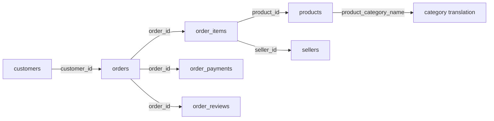

# Olist 巴西電商：SQL 多表練習

這個專案使用 [Olist 在 Kaggle 公開的 Brazilian E-Commerce Public Dataset](https://www.kaggle.com/datasets/olistbr/brazilian-ecommerce)。資料已匯入 `03_Olist_Brazilian_Ecommerce` 專案。Kaggle API 標示授權為 **CC BY-NC-SA 4.0**；原始檔來源與匯入範圍也記在 `datasets/03_Olist_Brazilian_Ecommerce/SOURCE.md`。

## 開始練習

1. 啟動 DataFlow Studio，專案選 `03_Olist_Brazilian_Ecommerce`。
2. 資料表選 `olist_orders_dataset`。這是課程的主表；筆記中的 SQL 會 JOIN 同一專案內的其他表。
3. 在左側程式庫展開「📚 Olist｜SQL 多表分析練習」，依 SQL 01～12 順序選取筆記並按「執行」。
4. 每則筆記有目標、關聯說明、結果判讀與修改練習。修改後可按「另存新筆記」保留自己的答案。

原本自動產生的八則訂單範例仍在；新增的十二則課程以 `SQL 01`～`SQL 12` 命名。SQL 使用平台的 **SQLite** 語法，與網路上常見的 MySQL／PostgreSQL 教學可能略有不同。

八張表的 47 個欄位都已加入中英欄位字典。可在左側「欄位字典」檢視中文名稱與分析用途，或在上方「中英欄位字典」視窗切換資料表。切換到 Olist 專案時，工作台會優先選取 `olist_orders_dataset`，方便找到課程。

## 匯入的八張表

| 資料表 | 筆數 | 一列代表什麼 | 主要連結鍵 |
|---|---:|---|---|
| `olist_orders_dataset` | 99,441 | 一張訂單 | `order_id`、`customer_id` |
| `olist_customers_dataset` | 99,441 | 一筆訂單使用的顧客資料 | `customer_id`、`customer_unique_id` |
| `olist_order_items_dataset` | 112,650 | 一筆商品明細 | `order_id`、`product_id`、`seller_id` |
| `olist_order_payments_dataset` | 103,886 | 一筆付款紀錄 | `order_id` |
| `olist_order_reviews_dataset` | 99,224 | 一筆評價紀錄 | `order_id` |
| `olist_products_dataset` | 32,951 | 一個商品 | `product_id`、`product_category_name` |
| `olist_sellers_dataset` | 3,095 | 一位賣家 | `seller_id` |
| `product_category_name_translation` | 71 | 一個葡文類別的英文翻譯 | `product_category_name` |

原始壓縮包另含逾百萬筆地理座標資料 `olist_geolocation_dataset.csv`。這份入門專案先不匯入它，以維持工作台載入與練習速度；核心的訂單、顧客、商品、付款、評價、賣家關聯仍完整。

## 關聯與資料粒度

**最重要的觀念：一筆訂單可以有多筆商品與多筆付款。** 如果直接把 `orders`、`order_items`、`order_payments` 三表 JOIN，再 `SUM(price)` 或 `SUM(payment_value)`，多商品 × 多付款可能把金額重複放大。SQL 09 先把商品與付款各自彙總成「每單一列」，再 JOIN，示範正確做法。

顧客表的 `customer_id` 用來接訂單；分析同一人是否回購時，要用 `customer_unique_id`。賣家州別與顧客州別也代表不同角色，不能互換。

## 學習路線

| 課次 | 主題 | 會用到的 SQL |
|---|---|---|
| 01–02 | 看原始訂單、狀態比例 | `SELECT`、`LIMIT`、`GROUP BY`、子查詢 |
| 03–04 | 月度趨勢、交貨時間與準時率 | `strftime`、`julianday`、`CASE WHEN` |
| 05–07 | 顧客州別、訂單商品金額、商品類別 | `JOIN`、`LEFT JOIN`、`COUNT(DISTINCT)` |
| 08–09 | 付款方式、先彙總再 JOIN | 資料粒度、CTE、防止重複計算 |
| 10–12 | 評價與交貨、賣家州別、回購顧客 | 多表 JOIN、條件比較、`ROW_NUMBER()` |

## 結果判讀提醒

- **訂單量、付款筆數、商品明細列數不是同一指標。** 使用 COUNT 前先說清楚「一列」代表什麼。
- **商品銷售額不是利潤。** `SUM(price)` 不包含運費、退款、平台費、賣家成本等。SQL 09 的金額差也不是利潤。
- **月份首尾不完整。** 直接比較起始與結束月份的月增率容易誤判；先限制完整月份。
- **已送達與所有訂單的分母不同。** 物流與評價題目多半只分析已送達且日期完整的訂單，不能把其比例直接套到全部訂單。
- **關聯不是因果。** 若晚到訂單的評分較低，仍不能只憑這份觀察資料認定晚到是唯一原因。

匯入程式為 `scripts/import_olist.py`，練習筆記原始內容為 `olist_sql_lessons.py`，欄位字典來源為 `olist_column_dictionary.py`。再次執行筆記或字典安裝程式，只會補入缺少的項目，不會覆蓋同 ID 的筆記或已有的欄位解說。
